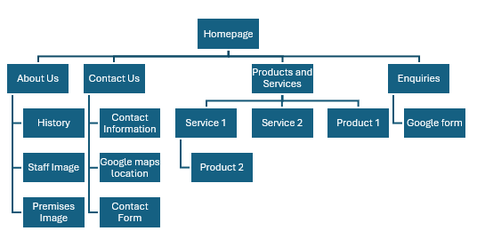

# WEDE5020 POE

## Name: Hylton Richard Schmahl
## Student Number: ST10503431
## Lecturer: Heinrich Engelbrecht
## Class: Group 2

### Project Overview

This website aims to make it easier for new clients to find information about Ebeth's business by providing an online platform that is easy to find, navigate, and understand. Ebeth currently does not have a dedicated website and relies mainly on word-of-mouth recommendations to attract new clients. Although the business is listed on Google Maps, it can still be difficult for potential clients to discover the business unless they specifically search for it. The website will help improve the business's online presence by providing potential clients with information about the history of the business, how it is operated, and what is important to Ebeth when working with a new client and creating a design.

Ebeth currently has limited experience and knowledge in online marketing and creating digital media, which is one of the main reasons for developing this website. The website will provide Ebeth with a professional online presence that can be used to showcase her work and attract potential new clients. The main objective of the website is to generate new business and support the continued growth of Ebeth's business by making it easier for potential clients to learn about and contact her.

The target audience for the website will primarily consist of women who are getting married, girls with an upcoming matric dance, women looking for new formal wear, and women who want to modernise or alter an existing dress to improve its appearance and fit. The website will provide users with information about the services offered, pricing, the background of the business, and information about Ebeth. It will also allow potential clients to arrange appointments and contact Ebeth regarding possible business opportunities or available positions. Overall, the website will act as a central online platform for the business, helping Ebeth reach a wider audience and attract new clients.

### Timeline and Milestones

July: Gathered initial information about the business

July - August: Webite planning and structure

August: Basic HTML design and website development

September: Part 1 Submission on the 1st

September: Further website development and introduction of styling

September - October: Testing and making small changes

October: Final Development and submission on the 5th

October: Implentation of JavaScript and applying SEO

October - November: Forms development and JavaScript validation

November: Deploy website on a free platform

### Part 1 Details

Part 1 focuses on the research, planning and initial development of the website for Ebeth's dress-design business. The aim of this stage is to establish a clear understanding of the business, its target audience and the requirements of the website. This includes researching the business and its users, identifying the main goals and objectives of the website, planning the website structure and developing the initial design and functionality. Parts 2 and 3 will be added to the README as they are completed in future submissions.

- Research and gathering of information
- Intial structure and website planning
- Intial HTML page information and basic development

### Sitemaps

### Changelog

26 August 2026

- Created HTML pages
- Added information and images to Index.html and about.html pages
- Added basic html to all pages
- Added navigation to all pages

29 August 2026

- Made changes to basic html on all pages
- Made changes to the navigation to all pages

30 August 2026

- Completed services page by adding information and images

31 August

- Added contact information to the contact page
- Made changes and additions to ReadME file

1 September

- Updated and finished part 1 of ReadME file

10 September 2026

- Removed the / that was added by mistake

11 September 2026

- Added style sheet and linked it to the project
- Made small CSS additions
- Made additional styling changes to the header section and nav bar

14 September 2026

- Added wrapper to all pages
- Added a bottom border to the header
- Added cycle animation to the homepage
- Made small changes to the animation on the homepage

15 September 2026

- Added more animations to all screens
- Added more styling to the index page
- Updated index.html

17 September 2026

- Removed header from all pages

27 September 2026

- Added styling changes to the home page

28 September 2026

- Added all files and folders from previous repo
- Made styling changes and other changes to the Home page

30 September 2026

- Added footer styling

1 October 2026

- Finished styling for the footer
- Completed styling for Index and About Us pages
- Added more styling and fixes to footer

4 October 2026

- Completed styling on the About Us and Services pages
- Added each individual packages / services page
- Completed styling for responsive design

5 October 2026

- Added button to the index page and made universal button styling
- Completed all individual service pages
- Added a new style page specifically for the individual packages
- Completed all styling and responsive design for all pages
- Completed requirements for part 2

27 October 2026

- Added all of the forms into the contact and enquiries pages
- Added all validation using JavaScript, jQuery and JSON files

8 November 2026

- Added in-depth alt tags for images for initial SEO
- Added descriptions for each page in order to optimise SEO
- Added the actual phone number and added the final SEO HTML to pages
- Added SEO into the packages pages and added the sitemap, _headers and robots.txt files to the project
- Moved files into the main root folder to help with deployment
- Completed changes that allow the website to be published correctly
- Removed files that were no longer needed

9 November 2026

- Changed all the contact information to the correct information
- Matched the full local version of the code to the published website
- Added the gallery page and removed the old images folder
- Completed all changes and additions associated with the new gallery page
- Fully completed navigation updates, with the search and filter feature added to the services page
- Updated the domain address
- Added blurred faces to the images

### References

Cloudinary. 2025. 4 Ways to Add Images to GitHub README + 1 Bonus Method. [Online]. Available at: https://cloudinary.com/guides/web-performance/4-ways-to-add-images-to-github-readme-1-bonus-method [Accessed 30 August 2026].

GitHub. 2026. Basic writing and formatting syntax. [Online]. Available at: https://docs.github.com/en/get-started/writing-on-github/getting-started-with-writing-and-formatting-on-github/basic-writing-and-formatting-syntax [Accessed 26 August 2026].

Google Search Central. 2026a. Build and submit a sitemap. [Online]. Available at: https://developers.google.com/search/docs/crawling-indexing/sitemaps/build-sitemap [Accessed 9 November 2026].

Google Search Central. 2026b. Introduction to robots.txt. [Online]. Available at: https://developers.google.com/search/docs/crawling-indexing/robots/intro [Accessed 9 November 2026].

Google Search Central. 2026c. SEO Starter Guide: The Basics. [Online]. Available at: https://developers.google.com/search/docs/fundamentals/seo-starter-guide [Accessed 9 November 2026].

MDN Web Docs. 2026a. Client-side form validation. [Online]. Available at: https://developer.mozilla.org/en-US/docs/Learn_web_development/Extensions/Forms/Form_validation [Accessed 9 November 2026].

MDN Web Docs. 2026b. Working with JSON. [Online]. Available at: https://developer.mozilla.org/en-US/docs/Learn_web_development/Core/Scripting/JSON [Accessed 9 November 2026].

OpenJS Foundation. 2026. jQuery API Documentation. [Online]. Available at: https://api.jquery.com/ [Accessed 9 November 2026].

W3C Web Accessibility Initiative (WAI). 2026. An alt Decision Tree. [Online]. Available at: https://www.w3.org/WAI/tutorials/images/decision-tree/ [Accessed 9 November 2026].

W3Schools. 2026a. HTML Tutorial. [Online]. Available at: https://www.w3schools.com/html/ [Accessed 27 August 2026].

W3Schools. 2026b. How TO - Lightbox. [Online]. Available at: https://www.w3schools.com/howto/howto_js_lightbox.asp [Accessed 9 November 2026].